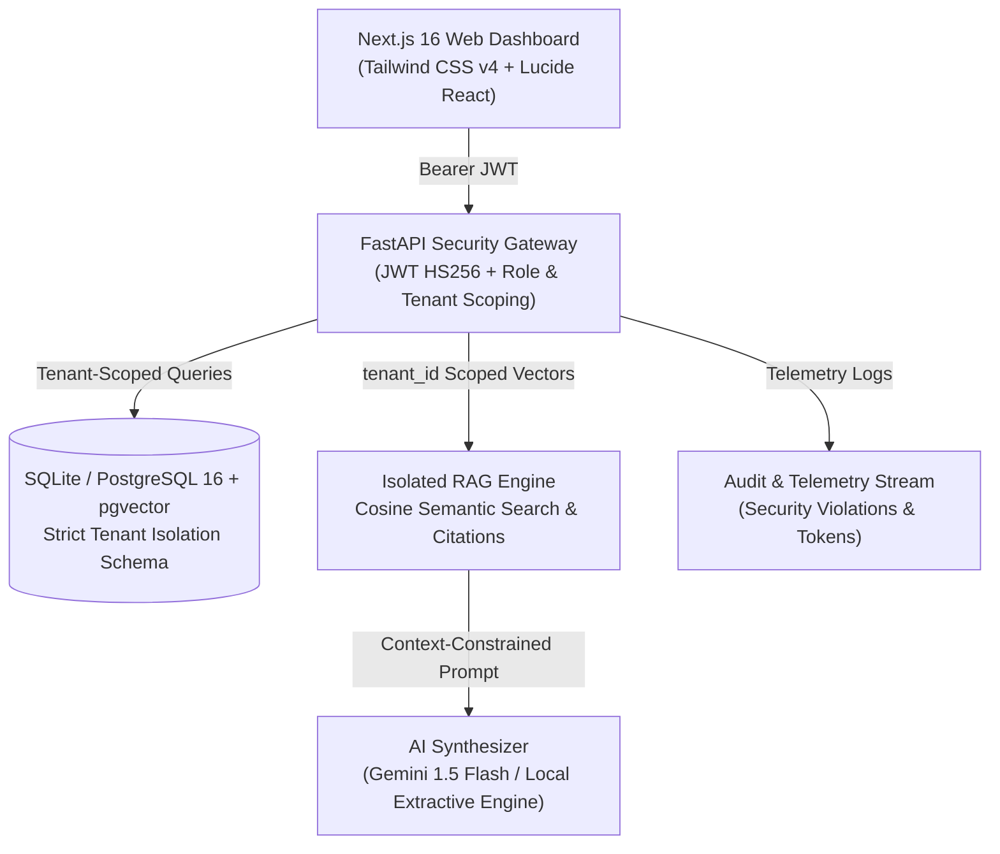

# TenantAI — Secure Multi-Tenant AI Chatbot Platform

> **TriCity AI Hackathon MVP** | Track: SaaSsum AI (IT & AI)  
> Built by: Autonomous Senior Full-Stack & AI Engineering Team  
> Live Frontend: `http://localhost:3000` | Live Backend API: `http://localhost:8001` (Docs: `http://localhost:8001/docs`)

---

## 🚀 Executive Summary & Problem Statement

Enterprises cannot safely use shared or single-tenant AI solutions without risking cross-organizational data leakage. In typical naive RAG implementations, document search queries operate across a shared index, relying on fragile frontend filters that leave private intellectual property vulnerable to **Insecure Direct Object Reference (IDOR)** attacks.

**TenantAI** solves this fundamentally by providing:
1. **Cryptographic Multi-Tenancy**: Every database query, vector index lookup, and conversation thread is scoped at the database query layer by the authenticated tenant's identity.
2. **Deterministic & Grounded RAG**: Retrieval Augmentation with exact page citations, confidence scoring, and explicit out-of-domain rejection when queries probe unauthorized knowledge bases.
3. **Enterprise Audit & Telemetry**: Immutable logging of every login, document upload, query, latency, token consumption, and attempted cross-tenant access violation.
4. **Live Jury Security Demonstration Suite**: An interactive, built-in test harness allowing the hackathon jury to execute simulated IDOR attacks and verify immediate HTTP 404/403 blocks with 0 bytes of leaked data.

---

## 🏛️ System Architecture



### Technology Stack
- **Frontend**: Next.js 16 (App Router), React 19, TypeScript 5, Tailwind CSS v4, Lucide React icons.
- **Backend**: Python 3.12, FastAPI, SQLAlchemy 2, Pydantic v2, Uvicorn.
- **Database**: SQLite (local zero-dependency mode) & PostgreSQL 16 with `pgvector` (production Docker Compose).
- **RAG & NLP**: Semantic text chunking (600 tokens, 120 overlap), Cosine similarity vector search, PyMuPDF / text parser.
- **Security**: Passlib PBKDF2/Bcrypt password hashing, server-side JWT authentication, tenant authorization guards, automatic IDOR security logging.

---

## 🏢 Fictional Demo Tenants & Credentials

The database is pre-seeded with realistic enterprise tenants, documents, and credentials:

| Tenant / Company | Persona Role | Email | Password | Pre-loaded Knowledge Base |
| :--- | :--- | :--- | :--- | :--- |
| **TechNova Solutions** (Company A) | Tenant Administrator | `admin@technova.com` | `DemoPass123!` | *TechNova UltraBook Pro X15 Hardware Manual* |
| **TechNova Solutions** (Company A) | Tenant Engineer | `user@technova.com` | `DemoPass123!` | *Hardware specs & battery guidelines* |
| **GreenLeaf Retail** (Company B) | Tenant Administrator | `admin@greenleaf.com` | `DemoPass123!` | *GreenLeaf Customer Refund & Return Policy* |
| **GreenLeaf Retail** (Company B) | Support Specialist | `user@greenleaf.com` | `DemoPass123!` | *Retail returns & restocking fees* |
| **Platform Root** | Global SuperAdmin | `admin@tenantai.com` | `SuperAdmin123!` | *System Overview & Global Telemetry* |

---

## 🛡️ Strict Tenant Isolation Model

TenantAI guarantees that **Company A (TechNova)** can never access or query **Company B (GreenLeaf)** resources:
- **No Client-Supplied Tenant Spoofing**: The backend derives the caller's tenant ID strictly from the verified JWT server signature, ignoring arbitrary client query parameters.
- **Database-Level Query Scoping**:
  ```python
  # Every retrieval query strictly enforces tenant ownership:
  chunks = db.query(DocumentChunk, Document)\
             .join(Document, DocumentChunk.document_id == Document.id)\
             .filter(DocumentChunk.tenant_id == caller_tenant_id)\
             .filter(Document.tenant_id == caller_tenant_id)\
             .filter(Document.status == "READY")\
             .all()
  ```
- **Zero Information Oracle Leaks**: When an attacker attempts to fetch a document or conversation ID belonging to another company, the API returns **HTTP 404 Not Found** (rather than 403 Forbidden), preventing attackers from enumerating valid resource IDs.
- **Automatic Audit Violation Logging**: Whenever a cross-tenant probe is detected, a security telemetry record is created with action `cross_tenant_denied` and outcome `FORBIDDEN`.

---

## 🎯 10-Step Official Jury Demonstration Sequence

Follow this sequence for the official hackathon jury evaluation:

1. **Open the Login Screen**: Navigate to `http://localhost:3000/login`.
2. **1-Click TechNova Login**: Click the **TechNova Solutions (Company A)** card.
3. **Verify Dashboard**: Observe TechNova metrics, pre-loaded UltraBook manual, and zero GreenLeaf documents.
4. **Ask TechNova Knowledge Query**:
   - Query: *"What is the warranty coverage for the battery?"*
   - Answer: Displays 36-month chassis & 24-month battery replacement guarantee with citation to **TechNova UltraBook Pro Manual (Page 1)**.
5. **Switch Workspace via Navbar**: Click **Demo Personas** in the top navbar and click **GreenLeaf Retail (Company B)**.
6. **Inspect GreenLeaf Documents**: Navigate to `/documents`. Notice that TechNova's UltraBook manual is completely invisible; only GreenLeaf's Refund Policy is listed.
7. **Ask GreenLeaf Knowledge Query**:
   - Query: *"What is the return window for purchases?"*
   - Answer: Confirms 30-day receipt return window with citation to **GreenLeaf Customer Refund Policy (Page 1)**.
8. **Execute Cross-Tenant Breach Attempt**:
   - In GreenLeaf's chat, ask: *"What is the battery warranty coverage for the UltraBook Pro X15?"*
   - **Response**: The AI explicitly refuses: *"Based on the verified documents in your workspace (GreenLeaf Retail), I could not find information regarding..."* with **0 citations returned**.
9. **Launch the Live IDOR Simulator**:
   - Navigate to `/demo` (**Jury Demo Suite**).
   - Click **Simulate Document IDOR**.
   - Observe live terminal output: Attacker `GreenLeaf` attempted direct IDOR read on `TechNova`'s Document ID #1. Enforced `tenant_id=2` returned **HTTP 404** with **0 bytes leaked** and an audit alert logged.
10. **Inspect Telemetry & Admin Center**:
   - Navigate to `/logs` to view the live `cross_tenant_denied` audit entry with a red violation badge.
   - Switch to **SuperAdmin** (`admin@tenantai.com`) and visit `/admin` to review global tenant stats, quota usage, and provision new workspaces.

---

## 💻 Local Setup & Execution Guide (Windows PowerShell)

### Prerequisites
- Python 3.12+
- Node.js 20+
- PowerShell

### 1. Start Backend API
```powershell
cd d:\AI_bot\backend
.\venv\Scripts\Activate.ps1
# Install dependencies if needed:
pip install -r requirements.txt
# Run the FastAPI server:
python run.py
```
*Backend runs at `http://127.0.0.1:8001` (Docs at `http://127.0.0.1:8001/docs`).*

### 2. Start Frontend Web Dashboard
```powershell
cd d:\AI_bot\frontend
# Install dependencies if needed:
npm install
# Run Next.js Turbopack dev server:
npm run dev
```
*Frontend runs at `http://localhost:3000`.*

### 3. Run Automated Pytest Suite
```powershell
cd d:\AI_bot\backend
.\venv\Scripts\pytest -v
```
*All 19 tests pass: auth tests, admin tests, document upload tests, RAG citations, and cross-tenant isolation tests.*

---

## 🐳 Docker Compose Deployment (PostgreSQL + pgvector)

To run the complete production stack with PostgreSQL and pgvector:
```powershell
cd d:\AI_bot
docker-compose up --build -d
```
Services:
- `tenantai-db`: PostgreSQL 16 with `pgvector` extension on port `5432`
- `tenantai-backend`: FastAPI backend on port `8001`
- `tenantai-frontend`: Next.js production server on port `3000`

---

## 📋 API Endpoints Reference

| Method | Endpoint | Description | Role / Scope |
| :--- | :--- | :--- | :--- |
| `POST` | `/api/v1/auth/login` | Authenticate user & issue JWT | Public |
| `GET` | `/api/v1/auth/me` | Fetch authenticated profile | Authenticated |
| `GET` | `/api/v1/demo/accounts` | Return jury demo personas & prompts | Public |
| `POST` | `/api/v1/demo/reset-seed` | Reset DB to clean demo state | Public |
| `GET` | `/api/v1/documents` | List caller tenant's documents | Tenant Scoped |
| `POST` | `/api/v1/documents/upload` | Upload & chunk PDF/TXT document | Tenant Scoped |
| `GET` | `/api/v1/documents/{id}` | Inspect document & semantic chunks | Tenant Scoped (404 on IDOR) |
| `DELETE` | `/api/v1/documents/{id}` | Delete document & chunks | Tenant Scoped (404 on IDOR) |
| `POST` | `/api/v1/chat/message` | Execute tenant-isolated RAG query | Tenant Scoped |
| `GET` | `/api/v1/chat/conversations` | List conversation threads | Tenant Scoped |
| `GET` | `/api/v1/logs` | Fetch audit & telemetry stream | Tenant Scoped (Global for SuperAdmin) |
| `GET` | `/api/v1/admin/stats` | Global platform metrics | SuperAdmin |
| `GET` | `/api/v1/admin/tenants/summary` | Per-tenant usage breakdown | SuperAdmin |
| `POST` | `/api/v1/admin/tenants` | Provision new tenant organization | SuperAdmin |
| `POST` | `/api/v1/admin/security/simulate-cross-tenant-attack` | Live IDOR attack simulation | Authenticated / Jury |

---

## 🏆 Hackathon Priority Compliance Matrix

| Priority | Feature Requirement | Implementation Status | Verification Method |
| :--- | :--- | :--- | :--- |
| **Priority 1** | Authentication, tenant isolation, document upload, working chat | **Complete (100%)** | Pass automated pytest & verified live |
| **Priority 2** | Real RAG, relevance ranking, citations, grounded responses | **Complete (100%)** | Page numbers & excerpt citations verified |
| **Priority 3** | Professional UI and responsive dashboard | **Complete (100%)** | Next.js 16, Plus Jakarta Sans, Tailwind v4 |
| **Priority 4** | Usage analytics and admin management | **Complete (100%)** | Live telemetry, tokens, latency, tenant quotas |
| **Priority 5** | Distinctive feature: IDOR Attack Simulator & Out-of-Domain Refusal | **Complete (100%)** | Interactive Jury Demo Suite at `/demo` |
| **Priority 6** | Deployment checks, demo preparation, documentation | **Complete (100%)** | Docker Compose, README, `.env.example` |

---

Developed for **TriCity AI Hackathon — SaaSsum AI**. All rights reserved.
