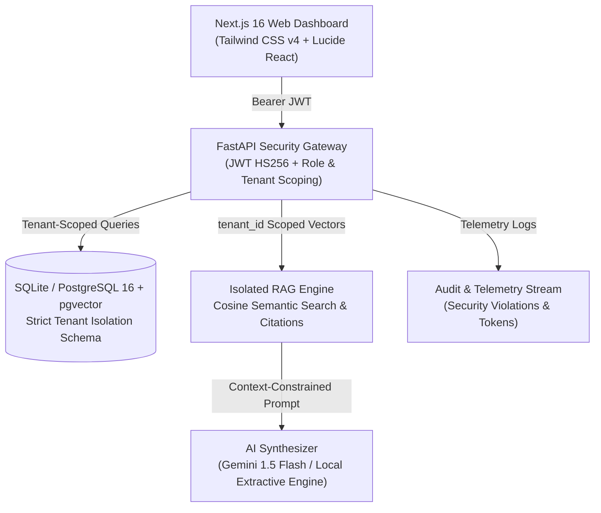

# SaaSum AI — Secure Multi-Tenant AI Chatbot Platform

> **TriCity AI Hackathon MVP** | Track: SaaSum AI (IT & AI)  
> Built by: Autonomous Senior Full-Stack & AI Engineering Team  
> Live Frontend: `http://localhost:3000` | Live Backend API: `http://localhost:8001` (Docs: `http://localhost:8001/docs`)

---

## 🚀 Executive Summary & Problem Statement

Enterprises cannot safely use shared or single-tenant AI solutions without risking cross-organizational data leakage. In typical naive RAG implementations, document search queries operate across a shared index, relying on fragile frontend filters that leave private intellectual property vulnerable to **Insecure Direct Object Reference (IDOR)** attacks.

**TenantAI** solves this fundamentally by providing:
1. **Cryptographic Multi-Tenancy**: Every database query, vector index lookup, and conversation thread is scoped at the database query layer by the authenticated tenant's identity.
2. **Deterministic & Grounded RAG**: Retrieval Augmentation with exact page citations, confidence scoring, and explicit out-of-domain rejection when queries probe unauthorized knowledge bases.
3. **Enterprise Audit & Telemetry**: Immutable logging of every login, document upload, query, latency, token consumption, and attempted cross-tenant access violation.
4. **Live Jury Security Demonstration Suite**: An interactive, built-in test harness allowing the hackathon jury to execute simulated IDOR attacks and verify immediate HTTP 404/403 blocks with 0 bytes of leaked data.

---

## 🏛️ System Architecture



### Technology Stack
- **Frontend**: Next.js 16 (App Router), React 19, TypeScript 5, Tailwind CSS v4, Lucide React icons.
- **Backend**: Python 3.12, FastAPI, SQLAlchemy 2, Pydantic v2, Uvicorn.
- **Database**: SQLite (local zero-dependency mode) & PostgreSQL 16 with `pgvector` (production Docker Compose).
- **RAG & NLP**: Semantic text chunking (600 tokens, 120 overlap), Cosine similarity vector search, PyMuPDF / text parser.
- **Security**: Passlib PBKDF2/Bcrypt password hashing, server-side JWT authentication, tenant authorization guards, automatic IDOR security logging.

---

## 🔐 Current account lifecycle

New installations start without demo tenants or seeded credentials. A company administrator registers at `/register`, receives a six-digit OTP, verifies the email within five minutes, and can then sign in. OTP values are stored only as SHA-256 hashes. In development, leaving `SMTP_HOST` empty logs the code through the backend logger; configure SMTP before production use.

The explicit cleanup utility is `backend/scripts/cleanup_demo_data.py`. It performs a dry run by default and creates a timestamped SQLite backup before deleting only the known repository demo slugs (`technova`, `greenleaf`) when invoked with `--apply`. It is never run at application startup.

## 🏢 Legacy demo tenants

The repository still contains legacy seed fixtures used by the existing tenant-isolation test suite. They are not loaded by the application anymore and are not exposed by the frontend.

| Tenant / Company | Persona Role | Email | Password | Pre-loaded Knowledge Base |
| :--- | :--- | :--- | :--- | :--- |
| **TechNova Solutions** (Company A) | Tenant Administrator | `admin@technova.com` | `DemoPass123!` | *TechNova UltraBook Pro X15 Hardware Manual* |
| **TechNova Solutions** (Company A) | Tenant Engineer | `user@technova.com` | `DemoPass123!` | *Hardware specs & battery guidelines* |
| **GreenLeaf Retail** (Company B) | Tenant Administrator | `admin@greenleaf.com` | `DemoPass123!` | *GreenLeaf Customer Refund & Return Policy* |
| **GreenLeaf Retail** (Company B) | Support Specialist | `user@greenleaf.com` | `DemoPass123!` | *Retail returns & restocking fees* |
| Platform Root | Global SuperAdmin | test fixture only | test fixture only | test fixture only |

---

## 🛡️ Strict Tenant Isolation Model

TenantAI guarantees that **Company A (TechNova)** can never access or query **Company B (GreenLeaf)** resources:
- **No Client-Supplied Tenant Spoofing**: The backend derives the caller's tenant ID strictly from the verified JWT server signature, ignoring arbitrary client query parameters.
- **Database-Level Query Scoping**:
  ```python
  # Every retrieval query strictly enforces tenant ownership:
  chunks = db.query(DocumentChunk, Document)\
             .join(Document, DocumentChunk.document_id == Document.id)\
             .filter(DocumentChunk.tenant_id == caller_tenant_id)\
             .filter(Document.tenant_id == caller_tenant_id)\
             .filter(Document.status == "READY")\
             .all()
  ```
- **Zero Information Oracle Leaks**: When an attacker attempts to fetch a document or conversation ID belonging to another company, the API returns **HTTP 404 Not Found** (rather than 403 Forbidden), preventing attackers from enumerating valid resource IDs.
- **Automatic Audit Violation Logging**: Whenever a cross-tenant probe is detected, a security telemetry record is created with action `cross_tenant_denied` and outcome `FORBIDDEN`.

---

## 🎯 10-Step Official Jury Demonstration Sequence

Follow this sequence for the official hackathon jury evaluation:

1. **Open the Login Screen**: Navigate to `http://localhost:3000/login`.
2. **1-Click TechNova Login**: Click the **TechNova Solutions (Company A)** card.
3. **Verify Dashboard**: Observe TechNova metrics, pre-loaded UltraBook manual, and zero GreenLeaf documents.
4. **Ask TechNova Knowledge Query**:
   - Query: *"What is the warranty coverage for the battery?"*
   - Answer: Displays 36-month chassis & 24-month battery replacement guarantee with citation to **TechNova UltraBook Pro Manual (Page 1)**.
5. **Switch Workspace via Navbar**: Click **Demo Personas** in the top navbar and click **GreenLeaf Retail (Company B)**.
6. **Inspect GreenLeaf Documents**: Navigate to `/documents`. Notice that TechNova's UltraBook manual is completely invisible; only GreenLeaf's Refund Policy is listed.
7. **Ask GreenLeaf Knowledge Query**:
   - Query: *"What is the return window for purchases?"*
   - Answer: Confirms 30-day receipt return window with citation to **GreenLeaf Customer Refund Policy (Page 1)**.
8. **Execute Cross-Tenant Breach Attempt**:
   - In GreenLeaf's chat, ask: *"What is the battery warranty coverage for the UltraBook Pro X15?"*
   - **Response**: The AI explicitly refuses: *"Based on the verified documents in your workspace (GreenLeaf Retail), I could not find information regarding..."* with **0 citations returned**.
9. **Launch the Live IDOR Simulator**:
   - Navigate to `/demo` (**Jury Demo Suite**).
   - Click **Simulate Document IDOR**.
   - Observe live terminal output: Attacker `GreenLeaf` attempted direct IDOR read on `TechNova`'s Document ID #1. Enforced `tenant_id=2` returned **HTTP 404** with **0 bytes leaked** and an audit alert logged.
10. **Inspect Telemetry & Admin Center**:
   - Navigate to `/logs` to view the live `cross_tenant_denied` audit entry with a red violation badge.
   - Switch to **SuperAdmin** (`admin@tenantai.com`) and visit `/admin` to review global tenant stats, quota usage, and provision new workspaces.

---

## 💻 Local Setup & Execution Guide (Windows PowerShell)

### Prerequisites
- Python 3.12+
- Node.js 20+
- PowerShell

### 1. Start Backend API
```powershell
cd d:\AI_bot\backend
.\venv\Scripts\Activate.ps1
# Install dependencies if needed:
pip install -r requirements.txt
# Run the FastAPI server:
python run.py
```
*Backend runs at `http://127.0.0.1:8001` (Docs at `http://127.0.0.1:8001/docs`).*

### 2. Start Frontend Web Dashboard
```powershell
cd d:\AI_bot\frontend
# Install dependencies if needed:
npm install
# Run Next.js Turbopack dev server:
npm run dev
```
*Frontend runs at `http://localhost:3000`.*

### 3. Run Automated Pytest Suite
```powershell
cd d:\AI_bot\backend
.\venv\Scripts\pytest -v
```
*The current suite covers authentication, admin access, document upload, RAG citations, and cross-tenant isolation. Run it from `backend/` so the `app` package is on `PYTHONPATH`.*

### 4. Email verification configuration

The backend reads `.env` from the `backend` directory. For Gmail delivery:

1. Open your Google Account → **Security**.
2. Enable **2-Step Verification**.
3. Open **App passwords**, create one for this project, and copy the generated 16-character password.
4. Copy `backend/.env.example` to `backend/.env`.
5. Set `SMTP_USERNAME`, `SMTP_FROM_EMAIL` to your Gmail address and `SMTP_PASSWORD` to the Google App Password. Do not use your normal Gmail password.
6. Restart the backend before registering again.

PowerShell:

```powershell
cd backend
Copy-Item .env.example .env
notepad .env
python run.py
```

If `SMTP_HOST` is blank, the application does not send email; it prints a development OTP in the backend terminal instead. Check Gmail Spam/Promotions if SMTP is configured. A failed SMTP delivery now appears as an explicit backend error instead of silently looking successful.

---

## 🐳 Docker Compose Deployment (PostgreSQL + pgvector)

To run the complete production stack with PostgreSQL and pgvector:
```powershell
cd d:\AI_bot
docker-compose up --build -d
```
Services:
- `tenantai-db`: PostgreSQL 16 with `pgvector` extension on port `5432`
- `tenantai-backend`: FastAPI backend on port `8001`
- `tenantai-frontend`: Next.js production server on port `3000`

---

## 📋 API Endpoints Reference

| Method | Endpoint | Description | Role / Scope |
| :--- | :--- | :--- | :--- |
| `POST` | `/api/v1/auth/register` | Create a pending company administrator and send OTP | Public |
| `POST` | `/api/v1/auth/verify-email` | Verify the administrator email | Public |
| `POST` | `/api/v1/auth/resend-verification` | Rate-limited OTP resend | Public |
| `POST` | `/api/v1/auth/login` | Authenticate verified user & issue JWT | Public |
| `GET` | `/api/v1/auth/me` | Fetch authenticated profile | Authenticated |
| `GET` | `/api/v1/documents` | List caller tenant's documents | Tenant Scoped |
| `POST` | `/api/v1/documents/upload` | Upload & chunk PDF/TXT document | Tenant Scoped |
| `GET` | `/api/v1/documents/{id}` | Inspect document & semantic chunks | Tenant Scoped (404 on IDOR) |
| `DELETE` | `/api/v1/documents/{id}` | Delete document & chunks | Tenant Scoped (404 on IDOR) |
| `POST` | `/api/v1/chat/message` | Execute tenant-isolated RAG query | Tenant Scoped |
| `GET` | `/api/v1/chat/conversations` | List conversation threads | Tenant Scoped |
| `GET` | `/api/v1/logs` | Fetch audit & telemetry stream | Tenant Scoped (Global for SuperAdmin) |
| `GET` | `/api/v1/admin/stats` | Global platform metrics | SuperAdmin |
| `GET` | `/api/v1/admin/tenants/summary` | Per-tenant usage breakdown | SuperAdmin |
| `POST` | `/api/v1/admin/tenants` | Provision new tenant organization | SuperAdmin |
| `POST` | `/api/v1/admin/security/simulate-cross-tenant-attack` | Live IDOR attack simulation | Authenticated / Jury |

---

## 🚀 Deployment notes

The backend is deployable as a FastAPI container and the frontend as a Next.js container. Use managed PostgreSQL for production, persistent object storage for uploaded documents, a managed SMTP provider, and a worker-capable service if document processing becomes asynchronous. Configure `DATABASE_URL`, `SECRET_KEY`, `CORS_ORIGINS`, `STORAGE_DIR` or object storage settings, SMTP variables, `GEMINI_API_KEY`/`OPENAI_API_KEY` as applicable, and `NEXT_PUBLIC_API_URL`. Do not run the cleanup utility against production until the matching tenant list has been reviewed and the generated backup is verified.

Telegram integration is implemented in `backend/telegram_bot.py` and uses the existing backend database and tenant-scoped RAG APIs.

## 🏆 Hackathon Priority Compliance Matrix

| Priority | Feature Requirement | Implementation Status | Verification Method |
| :--- | :--- | :--- | :--- |
| **Priority 1** | Authentication, tenant isolation, document upload, working chat | **Implemented; registration/OTP added** | Backend tests and manual registration flow |
| **Priority 2** | Real RAG, relevance ranking, citations, grounded responses | **Complete (100%)** | Page numbers & excerpt citations verified |
| **Priority 3** | Professional UI and responsive dashboard | **Dark-first shell and auth screens implemented** | Run frontend lint/build after `npm install` |
| **Priority 4** | Usage analytics and admin management | **Complete (100%)** | Live telemetry, tokens, latency, tenant quotas |
| **Priority 5** | Distinctive feature: IDOR Attack Simulator & Out-of-Domain Refusal | **Complete (100%)** | Interactive Jury Demo Suite at `/demo` |
| **Priority 6** | Deployment checks, demo preparation, documentation | **Configuration documented; deployment remains operator action** | Docker Compose, README, `.env.example` |

---

Developed for **TriCity AI Hackathon — SaaSum AI**. All rights reserved.

## Telegram bot setup

The Telegram service is implemented in `backend/telegram_bot.py` and uses the same SQLAlchemy database, users, tenants, documents, RAG engine, conversations, and audit logs as the web application. It does not create a second database.

### Install and configure

```powershell
cd D:\AI_bot\backend
.\.venv\Scripts\Activate.ps1
pip install -r requirements.txt
Copy-Item .env.example .env -ErrorAction SilentlyContinue
notepad .env
```

Set the BotFather token in `backend/.env`:

```env
TELEGRAM_BOT_TOKEN=your-token-from-botfather
TELEGRAM_SESSION_TIMEOUT_SECONDS=120
```

Start the web API in one terminal:

```powershell
cd D:\AI_bot\backend
.\.venv\Scripts\Activate.ps1
$env:PYTHONPATH="."
python run.py
```

Start the Telegram bot in a second terminal:

```powershell
cd D:\AI_bot\backend
.\.venv\Scripts\Activate.ps1
$env:PYTHONPATH="."
python telegram_bot.py
```

### Bot commands

- `/start` - welcome and usage instructions
- `/login` - authenticate using a verified SaaSum AI account
- `/status` - show company and remaining session time
- `/help` - show commands
- `/logout` - immediately revoke the Telegram session
- After login, send a plain-text question about uploaded company documents

Telegram sessions are bound to the Telegram chat ID, scoped to the authenticated user's tenant, audited, and invalidated after 120 seconds without activity. The bot never stores the user's password.

### BotFather

1. Open Telegram and search for `@BotFather`.
2. Send `/newbot`.
3. Choose the display name `tenantAI`.
4. Choose the username `tenantAI_bot` if it is available. Telegram usernames are unique and must end in `bot`; if it is already taken, use a close variant such as `tenantAI_chat_bot`.
5. Copy the token and put it only in `backend/.env` as `TELEGRAM_BOT_TOKEN`.
6. Start `python telegram_bot.py`, open your bot in Telegram, and send `/start`.
# Sample documents

The `backend/sample_documents` folder contains safe upload-ready TXT files:

- `acme_support_handbook.txt`
- `northstar_employee_policy.txt`
- `greenleaf_product_warranty.txt`
- `saasum_demo_questions.txt`

Upload documents one at a time from the web application's Documents page. Use questions from `saasum_demo_questions.txt` to demonstrate grounded answers and out-of-domain refusal.


